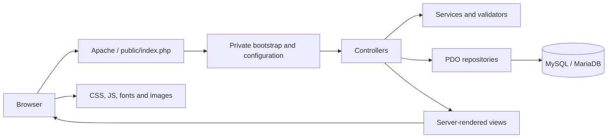

# ARA Studio

**The production website and administration system for ARA Studio, a Persian digital design and development studio.**

[Live website](https://ara-studio.ir) · [Security](SECURITY.md) · [Deployment](DEPLOYMENT.md) · [Agent guidelines](AGENTS.md)

ARA Studio presents web design, e-commerce, landing page, visual identity, UI/UX, and custom digital solution services through a responsive Persian RTL experience. The repository also contains the native PHP administration system used to receive consultation requests, manage portfolio content, maintain administrator accounts, update public contact information, and control homepage SEO.

The studio services described by the public website are business offerings. The CMS, API, authentication, and operational tooling described below are implemented in this repository. No client history, pricing, testimonials, performance guarantees, or business statistics are implied.

> **Production status:** ARA Studio is publicly deployed at [ara-studio.ir](https://ara-studio.ir). Deployment status is distinct from verification scope: contributors must report which checks they actually ran for a change and must not infer unperformed runtime, database, browser, or security test results.

## Contents

- [Capabilities](#capabilities)
- [Technology and architecture](#technology-and-architecture)
- [Repository structure](#repository-structure)
- [Application areas](#application-areas)
- [Routes and API](#routes-and-api)
- [Database migrations](#database-migrations)
- [Security](#security)
- [Installation overview](#installation-overview)
- [Production and verification](#production-and-verification)
- [Maintenance and documentation](#maintenance-and-documentation)
- [Contact](#contact)

## Capabilities

### Public experience

- Responsive Persian RTL landing page with locally hosted Vazirmatn typography.
- Consultation-oriented service presentation without fixed pricing.
- Accessible mobile navigation, restrained motion, and reduced-motion support.
- Consultation form with Persian loading, success, and error feedback.
- Public portfolio populated exclusively from published database records, with a dedicated empty state when none are available.
- Database-backed brand and contact information.
- Dynamic homepage metadata, Organization JSON-LD, `robots.txt`, and `sitemap.xml`.

### Administration

- Secure login/logout and authenticated dashboard.
- Consultation search, pagination, workflow status, private notes, and confirmed deletion.
- Portfolio CRUD with draft/published states, ordering, images, and optional per-project Telegram post links.
- Equal-permission administrator creation, password rotation, activation, and deactivation safeguards.
- Allow-listed public site settings.
- Homepage SEO, social metadata, verification tokens, robots controls, and social image management.

## Technology and architecture

| Layer | Implementation |
| --- | --- |
| Backend | Native PHP 8.2+, strict types, small PSR-style namespace autoloader |
| Database | MySQL/MariaDB through PDO with native prepared statements and `utf8mb4` |
| Frontend | Server-rendered HTML5, CSS, and dependency-free vanilla JavaScript |
| Typography | Locally hosted Vazirmatn WOFF2 |
| Web server | Apache with `.htaccess` routing and upload-directory hardening |
| Hosting | Shared cPanel with separate public and private roots |
| Dependencies | No framework, Composer package, Node runtime, or build step |

`public/index.php` is the only public PHP entry point. It discovers the private application, loads `bootstrap/app.php`, applies configuration and security headers, routes requests to focused controllers, and renders private PHP views. Controllers coordinate validation and use services or repositories for authentication, persistence, settings, portfolio, and SEO operations. PDO repositories communicate with MySQL/MariaDB; templates render escaped server-side output; CSS and JavaScript remain static public assets.



Protected controllers call the shared authentication boundary on every request. Mutations are POST-only, same-origin checked, CSRF protected, strictly validated, and routed to fixed destinations.

## Repository structure

```text
ARA/
├── app/
│   ├── Auth/                 authentication, sessions and account lifecycle
│   ├── Config/               environment loader
│   ├── Consultation/         request validation and persistence
│   ├── Database/             PDO connection factory
│   ├── Http/                 controllers, JSON handling, errors and headers
│   ├── Portfolio/            portfolio repository, validation and image storage
│   ├── Security/             CSRF, session, same-origin and rate limiting
│   ├── Seo/                  SEO settings, documents and social image storage
│   ├── Settings/             allow-listed public settings
│   └── Support/              HTML escaping helper
├── bin/                      private CLI database/provisioning utilities
├── bootstrap/app.php         autoloading, configuration and startup validation
├── config/                   application, database and feature configuration
├── database/migrations/      ordered manual SQL migrations
├── public/                   the only web-accessible source directory
│   ├── index.php             front controller and router
│   └── assets/               CSS, JS, fonts, logo and managed upload directories
├── resources/views/          public and admin PHP views
├── storage/                  private logs, locks, rate limits and provisioning input
├── README.md                 primary project documentation
├── AGENTS.md                 contributor and AI-agent instructions
├── SECURITY.md               security model and review baseline
└── DEPLOYMENT.md             cPanel installation, update and smoke-test runbook
```

In production, `public/` maps to `public_html/`. All other application directories, `.env`, logs, locks, migrations, CLI scripts, and views live in a sibling private `ara-studio/` directory outside the document root.

## Application areas

### Public website and consultation system

The public site presents ARA Studio's service categories, working principles, consultation process, and portfolio in Persian. JavaScript enhances navigation, one-time reveal effects, lightweight parallax, and the consultation form while respecting `prefers-reduced-motion`.

The form submits an exact JSON shape to `POST /api/consultation`. Server-side processing enforces an 8 KiB limit, field and format validation, an empty honeypot, CSRF, same-origin checks, a keyed file-backed rate limit, and a ten-minute duplicate window. A successful HTTP `201` is returned only after PDO persistence. Unexpected errors remain generic and are recorded privately without the request body.

Administrators can search requests by stored content, filter and paginate them, inspect full details, and move them through `new`, `in_progress`, `completed`, and `archived`. Private notes and the last updating administrator are stored separately from the public flow. Deletion requires an authenticated, CSRF-protected confirmation request.

### Administration panel

The Persian RTL admin interface provides:

- dashboard totals and recent consultation submissions;
- consultation management;
- portfolio management;
- administrator account management;
- public site settings; and
- SEO settings.

Authentication uses `password_hash()`/`password_verify()`, strict cookie-only PHP sessions, session ID regeneration, 30-minute idle and eight-hour absolute expiration, and a database-backed session version. Password changes or deactivation invalidate affected sessions. Self-deactivation and deactivation of the last active administrator are rejected. All administrators have equal permissions; there is no role system or public registration.

### Portfolio CMS

Administrators can create, inspect, update, publish, unpublish, order, and delete portfolio projects. Images can be uploaded, replaced, or removed. JPEG, PNG, and WebP content is checked using both image metadata and `fileinfo`, bounded by size and dimensions, renamed with random server filenames, and stored as relative paths in MySQL.

Each project may have one validated HTTPS `t.me` post URL. Published projects with a URL render the public «مشاهده بیشتر» CTA in a safe new tab; the CTA is omitted when no valid URL exists. Public queries return only published records ordered by `display_order` and stable `id`. Drafts never appear publicly.

### Site settings and SEO

Site settings are restricted to the brand name, website URL, Telegram URL, contact email, and optional public phone number. The UI cannot add arbitrary keys or store executable configuration.

SEO management covers the homepage title and meta description, same-host HTTPS canonical URL, Open Graph and Twitter/X metadata, a managed social image, index/follow controls, and optional Google/Bing verification tokens. Public output is escaped or safely JSON encoded. `robots.txt` excludes admin and API routes; `sitemap.xml` contains only the configured homepage because the application has no public project-detail routes. Organization JSON-LD uses only configured public business information.

## Routes and API

`{id}` is a positive integer. Every `/admin` route requires production HTTPS, and every admin route except login requires a current authenticated administrator.

| Method | Path | Purpose | Authentication |
| --- | --- | --- | --- |
| GET, HEAD | `/`, `/index.php` | Public homepage | No |
| POST | `/api/consultation` | Validate and persist a consultation request | Public session + CSRF |
| GET, HEAD | `/robots.txt`, `/sitemap.xml` | Dynamic public SEO documents | No |
| GET, POST | `/admin/login` | Login form and authentication | No |
| POST | `/admin/logout` | End the current session | Yes |
| GET | `/admin` | Dashboard | Yes |
| GET | `/admin/consultations` | Searchable consultation list | Yes |
| GET | `/admin/consultations/{id}` | Consultation detail | Yes |
| POST | `/admin/consultations/{id}/status` | Change workflow status | Yes |
| POST | `/admin/consultations/{id}/notes` | Save private notes | Yes |
| POST | `/admin/consultations/{id}/delete` | Confirmed deletion | Yes |
| GET | `/admin/portfolio` | Portfolio list | Yes |
| GET, POST | `/admin/portfolio/create` | Create form and project creation | Yes |
| GET | `/admin/portfolio/{id}` | Portfolio project editor | Yes |
| POST | `/admin/portfolio/{id}/update` | Update content or image | Yes |
| POST | `/admin/portfolio/{id}/publication` | Publish or unpublish | Yes |
| POST | `/admin/portfolio/{id}/delete` | Confirmed project deletion | Yes |
| GET | `/admin/admins` | Administrator list | Yes |
| GET, POST | `/admin/admins/create` | Account form and creation | Yes |
| GET | `/admin/admins/{id}` | Account detail | Yes |
| POST | `/admin/admins/{id}/password` | Password change | Yes |
| POST | `/admin/admins/{id}/status` | Activate or deactivate account | Yes |
| GET, POST | `/admin/settings` | View or save public settings | Yes |
| GET, POST | `/admin/seo` | View or save SEO settings | Yes |

Unsupported methods return `405`; unmatched routes return `404`.

## Database migrations

Migrations are manual, forward-only SQL files. Apply them once, in numeric order. They are not run by web requests or deployment code.

| Version | File | Purpose |
| --- | --- | --- |
| 0000 | `0000_database_foundation.sql` | Establishes `utf8mb4` and UTC session conventions; creates no table. |
| 0001 | `0001_create_consultation_requests.sql` | Creates consultation fields, default `new` status, timestamps, and indexes. |
| 0002 | `0002_create_admins.sql` | Creates unique administrator usernames, password hashes, active state, and timestamps. |
| 0003 | `0003_extend_consultation_workflow.sql` | Adds private notes, last-updating administrator, workflow constraint, indexes, and foreign key. |
| 0004 | `0004_create_portfolio_projects.sql` | Creates portfolio content, image/link fields, ordering, publication state, constraints, and indexes. |
| 0005 | `0005_create_site_settings.sql` | Creates allow-listed public settings with administrator attribution and approved defaults. |
| 0006 | `0006_add_admin_session_version.sql` | Adds durable administrator session invalidation. |
| 0007 | `0007_create_seo_settings.sql` | Creates the singleton SEO record, validation constraints, attribution, and approved defaults. |

The persistent entities are `consultation_requests`, `admins`, `portfolio_projects`, `site_settings`, and `seo_settings`. Consultation workflow, site settings, and SEO rows can reference an administrator with `ON DELETE SET NULL`, preserving business content if an account is later removed at the database level. Application account management does not provide account deletion.

There is no migration ledger or automated down migration. Back up the database and runtime uploads before applying changes, inspect the current schema, and import only unapplied files. [DEPLOYMENT.md](DEPLOYMENT.md) defines the supported procedure and rollback boundary.

## Security

Implemented controls include:

- per-request authorization for protected routes;
- password hashing and generic login failures;
- strict sessions, secure cookie attributes, expiration, regeneration, and credential-version invalidation;
- CSRF tokens and same-origin checks for mutations;
- allow-listed server-side input validation and bounded request sizes;
- native PDO prepared statements with emulation disabled;
- contextual HTML escaping and safe JSON encoding;
- keyed file-backed login/API rate limiting and duplicate-submission locking;
- validated random-name image uploads, path-constrained deletion, and non-executable upload directories;
- fixed redirect targets and POST-only destructive actions;
- private `.env`, application files, logs, migrations, and provisioning input;
- generic public errors with private reference-based logging; and
- CSP, HSTS on production HTTPS, clickjacking, MIME, referrer, permissions, opener, and resource-policy headers.

HTTPS decisions use Apache/PHP's trusted HTTPS state or port `443`; raw forwarding headers are not trusted. These controls have received focused source review, but the project does **not** claim an independent security audit or penetration test. See [SECURITY.md](SECURITY.md) for the complete security baseline.

## Installation overview

Prerequisites:

- PHP 8.2+ with `PDO`, `pdo_mysql`, `fileinfo`, `session`, `filter`, and `json`;
- MySQL 8 or compatible MariaDB;
- Apache `mod_rewrite` and recommended `mod_headers`;
- `file_uploads=On`, `upload_max_filesize>=5M`, and `post_max_size>=6M` for managed images.

For a local environment that matches production routing:

1. Copy `.env.example` to `.env` and replace every placeholder with private local values.
2. Set `APP_ENV=local`, an accurate local `APP_URL`, and a private `APP_KEY` of at least 32 characters.
3. Create a database and import migrations `0000` through `0007` in order.
4. Make `storage/logs`, `storage/locks`, `storage/rate-limits`, and both public upload directories writable by PHP.
5. Configure Apache with `public/` as the document root, `mod_rewrite` enabled, and `.htaccess` overrides allowed. Keep the application directories outside that document root.
6. Verify real PDO connectivity from the repository root:

   ```bash
   php bin/database-check.php
   ```

Administrator provisioning is private and CLI-only. `bin/provision-admins.php` accepts exactly two accounts from a permission-restricted private JSON file and refuses a non-empty administrators table. There is no browser setup endpoint.

For shared cPanel, do not upload the repository root to `public_html`. Use the supported two-root archive, create `.env` only in the private directory, preserve runtime uploads, apply migrations manually, and follow [DEPLOYMENT.md](DEPLOYMENT.md) for fresh installation, updates, permissions, provisioning, rollback, and smoke tests. Never place real credentials in Git or a deployment archive.

## Production and verification

The website is deployed publicly at [ara-studio.ir](https://ara-studio.ir). That established deployment fact does not prove that every commit in this repository is currently deployed, nor does it imply that every feature has been independently audited or retested after each change.

Verification is change-specific. Reports should distinguish source inspection, static checks, PHP syntax checks, database-backed tests, browser tests, packaging checks, and target-host smoke tests. Record only checks that actually ran and state any unavailable environment or remaining production verification. The authoritative cPanel update, rollback, and smoke-test procedure is maintained in [DEPLOYMENT.md](DEPLOYMENT.md).

## Maintenance and documentation

Keep changes small and aligned with the existing controller/service/repository/view boundaries. Add a new numbered migration for schema evolution; never rewrite an applied migration. Preserve the public/private hosting boundary and runtime uploads. Future notification, reporting, or CMS work should reuse the existing authentication, CSRF, validation, escaping, error, and persistence utilities.

Documentation responsibilities:

- [AGENTS.md](AGENTS.md) — mandatory workflow and conventions for developers and AI coding agents.
- [SECURITY.md](SECURITY.md) — detailed security requirements and review checklist.
- [DEPLOYMENT.md](DEPLOYMENT.md) — authoritative cPanel installation, update, rollback, and runtime test procedure.

## Contact

- Website: [ara-studio.ir](https://ara-studio.ir)
- Telegram: [ARA_STUDIO_TM](https://t.me/ARA_STUDIO_TM)
- Email: [info@ara-studio.ir](mailto:info@ara-studio.ir)
